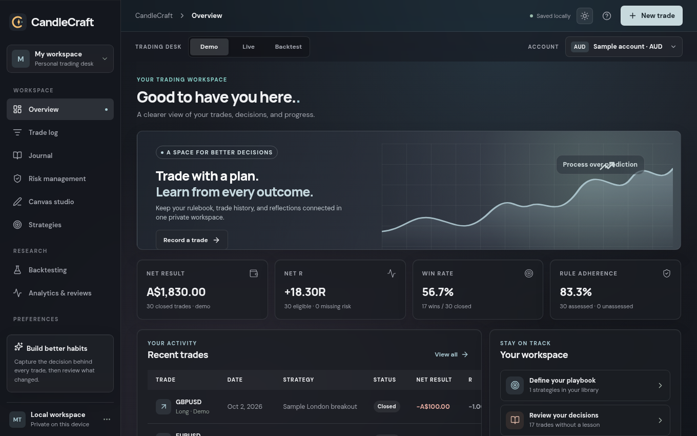
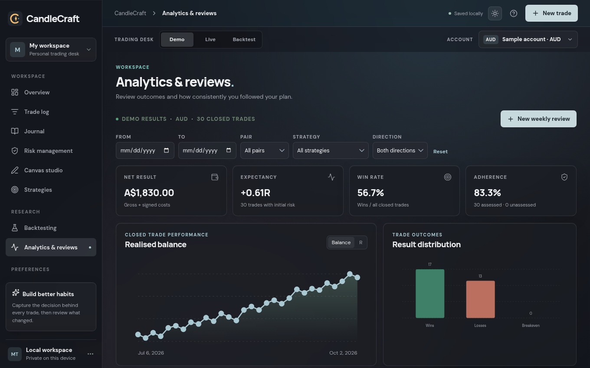
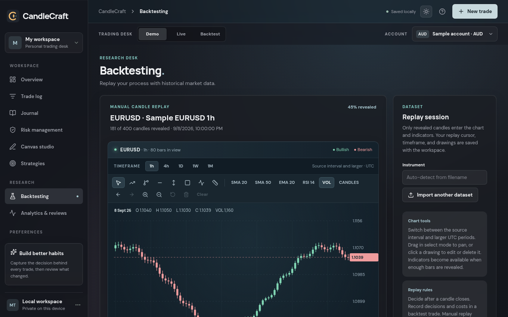

# CandleCraft

A desktop trading journal that keeps your rulebook, trades and reviews in one private, local workspace.

**[Try the live demo](https://zmyn-ahmadi.github.io/CandleCraft/)**: it runs in your browser with invented sample trades, and anything you change stays in your browser's local storage.



| Analytics | Backtest replay |
| --- | --- |
|  |  |

## Features

- **Trades:** one screen for the trade log and journal. Record trades with risk, costs, reasoning, lessons and before and after screenshots, or import them from CSV with column mapping and duplicate skipping. Saving a trade opens it ready for notes, and a Needs review queue counts closed trades still missing a lesson.
- **MetaTrader 5 sync:** positions sync in the background from your mt5-api, each shown on a whole-day M2 chart with entry, exit, SL/TP zones and R.
- **Strategy rulebooks:** versioned rules with required checklists, so each trade can be scored against the plan.
- **Analytics:** net result, R multiples, expectancy, win rate, drawdown and rule adherence, filtered by date, pair, strategy and direction, plus a monthly P&L calendar, breakdowns by pair, strategy and rules followed, and an all-accounts view per currency.
- **Backtest replay:** step through OHLC data candle by candle, with indicators and drawing tools. Trades taken in replay exit automatically at their stop or target, with per-session results.
- **Risk worksheet:** position sizing, drawdown and daily budget calculations.
- **Canvas Studio:** infinite boards for notes, drawings and chart pictures.

## Built with

TypeScript, React, Vite, Rust, Tauri 2 and SQLite. The replay chart is custom SVG; MT5 trade charts use TradingView Lightweight Charts.

## How your data is protected

Trading records are worth keeping, so saving is the most carefully built part of the app:

- Saves go through an ordered queue, so a slow write can't overwrite a newer one.
- SQLite runs in WAL mode with full synchronous commits.
- A latest copy and one dated copy per day are written to a local `backups` folder.
- If the workspace record is damaged, the app archives it, restores the newest valid copy and tells you. A failed load never saves an empty workspace over your data.

## Known limits

This is an early build. Replay trades fill at the candle close and exit at the stop or target; when one candle reaches both, the stop is assumed first, and spreads, slippage and commissions are not simulated. CSV import doesn't handle partial fills, and financial values use JavaScript numbers, so they need fixed precision before production use. Backups stay on the same device. The all-accounts view does not convert between currencies.

## MetaTrader 5 journal

Settings → MetaTrader 5 takes the mt5-api address (for example `https://your-server.your-tailnet.ts.net`) and its token. Both stay in this app's local storage, never in the workspace or its exports.

The app then syncs when it opens, every minute in the background on any screen, and from the Sync MT5 button above the trade list on the Trades screen. Each MT5 position becomes one trade keyed `mt5:<position id>`: new positions are added, open ones update until they close, and your reasoning, notes, lessons, tags, checklist, strategy, risk and screenshots are never touched. Trades go to the account whose currency matches the MT5 account (otherwise the selected one), under Live for a real account and Demo otherwise; a manual sync switches the view there.

A trade's journal entry opens with a TradingView Lightweight Charts M2 chart of every broker-server day the trade touches: entry and exit arrows at the fill prices, a green TP zone with its planned R, a red SL zone, and a dotted path to the exit with the R it made. Scroll to zoom into the trade. SL/TP come from the opening order; when the order had none, a stop or target that closed the trade is taken from its exit. Candles of finished days are cached in a `candle_cache` table beside the workspace (not inside it); the rest are fetched from the mt5-api's `/rates` endpoint. The mt5-api must allow the app's origin (CORS), which its `main.py` does for `tauri://localhost`, `http://tauri.localhost` and the dev server.

The field mapping is shared with the `candlecraft-mt5-sync` agent skill (`src/mt5.ts` and `skills/candlecraft-mt5-sync/scripts/sync.py`, held together by `tests/mt5.test.mjs` using the skill's fixture), so either can sync the same trades without duplicates.


## CSV formats

Trade imports expect a header row. Map instrument, direction, entry date, and profit or loss; optional columns include exit date, fees, swap, spread, initial risk, trade ID, size, entry/exit/stop/target prices, balance before entry, value per price unit, setup tag, rule adherence, and exit reason. Directions accept `buy`/`sell` or `long`/`short`. Rule adherence accepts `yes`, `no`, or `unassessed`; exit reason accepts `target`, `stop`, `manual`, `trailing`, or `other`. Dates need an unambiguous year. If profit is already net, select that option so fees, swap, and spread are not added again. Existing imports remain valid and missing risk fields are shown as unassessed.

## Feature notes

The Risk Management tab is a separate AUD worksheet. Enter the balance, personal limits, hypothetical entry/stop/target, daily figures, equity peaks, ordered equity checkpoints, and a rolling 20–30 result sample manually. It calculates cash risk, size, reward:risk, daily budget, current drawdown, historical maximum drawdown, expectancy, profit factor, and discipline, and shows reminders when entered figures meet a rule. Its notes and values persist in the workspace and JSON exports. The worksheet does not read or change trades, prevent trade entry, or place or close broker orders. Legacy risk profile data from 0.1.1 is retained; threshold settings are copied into the new worksheet on first load.

Canvas Studio lets you create collections and multiple canvases within each collection. Each canvas is infinite: scroll to pan in any direction, use the Hand tool to drag the view, and Ctrl/Command + scroll to zoom around the pointer. Fit all content returns distant items to view. The Text tool places editable text directly on the canvas with color and font size controls. Each board supports pen and highlighter strokes, lines, arrows, rectangles, movable and resizable notes and pictures, background styles, zoom, pan, and undo/redo during the current session. Add PNG, JPEG, or WebP pictures with the toolbar, drag-and-drop, or clipboard paste; pictures are optimized and stored inside the workspace so they are included in JSON exports and local backups. Picture uploads are limited to 12 MB before optimization and 4 MB of stored image data. Deleting a collection or canvas requires confirmation; undo history is kept for the current session rather than persisted across app restarts.

Replay imports expect date/time, open, high, low, and close columns, with optional volume. Ascending and newest-first files are accepted; dates are stored in UTC. The chart shows only revealed candles. Timeframe buttons offer the source interval and larger UTC periods, with OHLCV aggregation; a daily file cannot create intraday candles. The chart has candlestick and close-line modes, crosshair, volume, SMA 20/50, EMA 20, RSI 14, zoom, panning, history navigation, trendlines, rays, horizontal and vertical markers, price zones, Fibonacci retracements, and measurement. Drawings can be selected, edited by dragging their handles, undone, or deleted. Drawings, timeframe, and replay cursor are saved in the workspace. Importing another file replaces the active replay dataset and drawings; existing backtest trade records remain in the journal. Indicators need their full period of revealed bars.

## Run

```sh
npm install
npm run tauri dev
```

### Command line trade entry

```sh
cd src-tauri && cargo build --release --bin candlecraft
./target/release/candlecraft accounts
./target/release/candlecraft add --symbol AUDUSD --direction long --env live --entry 0.6612 --exit 0.6650 --risk 50 --gross 86.4 --fees -3
./target/release/candlecraft --help
```

The CLI writes to the desktop workspace with the same validation and backups. Close the desktop app before adding trades, because it saves its in-memory copy over the file. Journal fields (reasoning, notes, lessons, tags, checklist) are left empty for the app. Adding a trade again with the same `--ref` on the same account updates it and keeps its journal notes.

`skills/candlecraft-mt5-sync` is an agent skill that pulls a day's open and closed positions from the mt5-api (set `MT5_API_URL` to its Tailscale address) and records them through this CLI, for when the app is closed. With the app open, it syncs on its own. Re-adding keeps a trade's MT5 chart link: `MT5_API_URL=https://… MT5_API_TOKEN=… python3 skills/candlecraft-mt5-sync/scripts/sync.py 2026-10-28 --dry-run`.

For a browser preview without the desktop shell, use `npm run dev`. Browser preview data is stored in local storage; Tauri data is stored in the operating system's application data directory.

## Checks

```sh
npm run build
npm test
cd src-tauri && cargo check
cd src-tauri && cargo test
```

The frontend build, analytics and save queue tests, Rust check, and Rust storage tests pass in this workspace.
