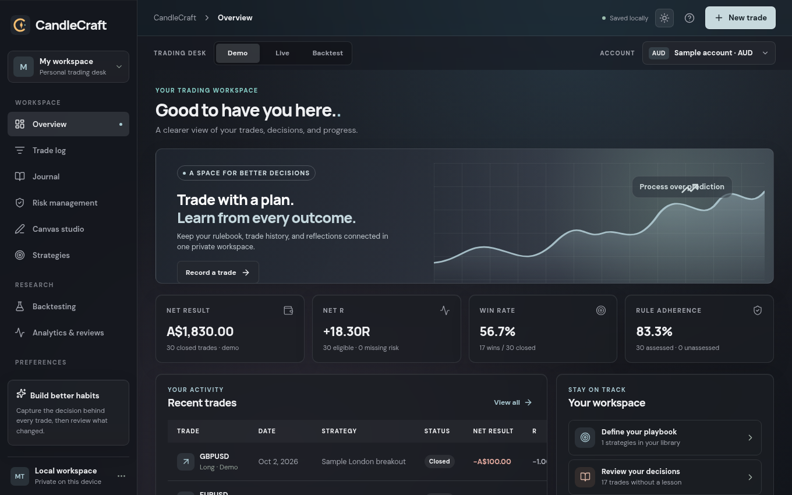
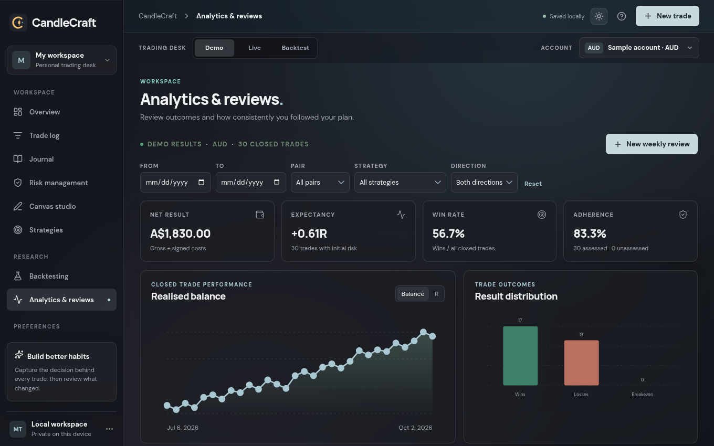
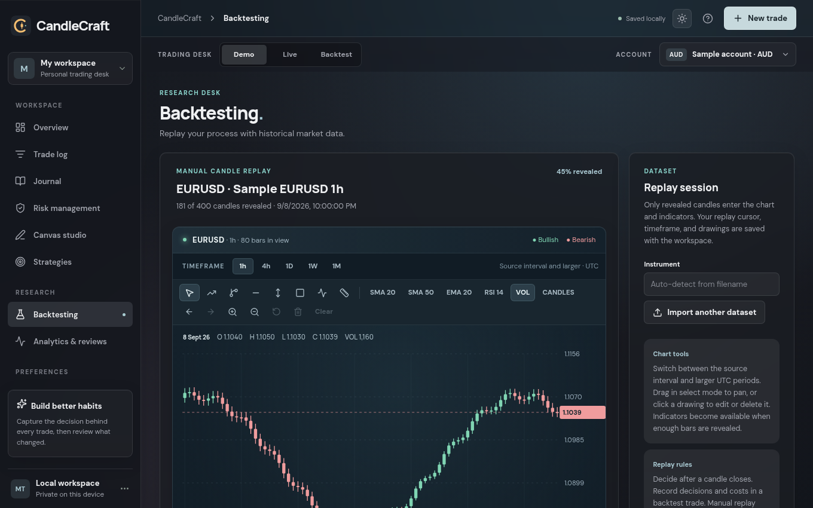

# CandleCraft

A desktop trading journal that keeps your rulebook, trades and reviews in one private, local workspace.

**[Try the live demo](https://zmyn-ahmadi.github.io/CandleCraft/)**: it runs in your browser with invented sample trades, and anything you change stays in your browser's local storage.



| Analytics | Backtest replay |
| --- | --- |
|  |  |

## Features

- **Trade log and journal:** record trades with risk, costs, reasoning, lessons and before and after screenshots, or import them from CSV with column mapping and duplicate skipping.
- **Strategy rulebooks:** versioned rules with required checklists, so each trade can be scored against the plan.
- **Analytics:** net result, R multiples, expectancy, win rate, drawdown and rule adherence, filtered by date, pair, strategy and direction.
- **Backtest replay:** step through OHLC data candle by candle, with indicators and drawing tools.
- **Risk worksheet:** position sizing, drawdown and daily budget calculations.
- **Canvas Studio:** infinite boards for notes, drawings and chart pictures.

## Built with

TypeScript, React, Vite, Rust, Tauri 2 and SQLite. The candlestick chart is custom SVG, not a charting library.

## How your data is protected

Trading records are worth keeping, so saving is the most carefully built part of the app:

- Saves go through an ordered queue, so a slow write can't overwrite a newer one.
- SQLite runs in WAL mode with full synchronous commits.
- A latest copy and one dated copy per day are written to a local `backups` folder.
- If the workspace record is damaged, the app archives it, restores the newest valid copy and tells you. A failed load never saves an empty workspace over your data.

## Known limits

This is an early build. Replay doesn't simulate fills, spreads or commissions, CSV import doesn't handle partial fills, and financial values use JavaScript numbers, so they need fixed precision before production use. Backups stay on the same device.

## CSV formats

Trade imports expect a header row. Map instrument, direction, entry date, and profit or loss; optional columns include exit date, fees, swap, spread, initial risk, trade ID, size, entry/exit/stop/target prices, balance before entry, value per price unit, setup tag, rule adherence, and exit reason. Directions accept `buy`/`sell` or `long`/`short`. Rule adherence accepts `yes`, `no`, or `unassessed`; exit reason accepts `target`, `stop`, `manual`, `trailing`, or `other`. Dates need an unambiguous year. If profit is already net, select that option so fees, swap, and spread are not added again. Existing imports remain valid and missing risk fields are shown as unassessed.

## Feature notes

The Risk Management tab is a separate AUD worksheet. Enter the balance, personal limits, hypothetical entry/stop/target, daily figures, equity peaks, ordered equity checkpoints, and a rolling 20–30 result sample manually. It calculates cash risk, size, reward:risk, daily budget, current drawdown, historical maximum drawdown, expectancy, profit factor, and discipline, and shows reminders when entered figures meet a rule. Its notes and values persist in the workspace and JSON exports. The worksheet does not read or change trades, prevent trade entry, or place or close broker orders. Legacy risk profile data from 0.1.1 is retained; threshold settings are copied into the new worksheet on first load.

Canvas Studio lets you create collections and multiple canvases within each collection. Each canvas is infinite: scroll to pan in any direction, use the Hand tool to drag the view, and Ctrl/Command + scroll to zoom around the pointer. Fit all content returns distant items to view. The Text tool places editable text directly on the canvas with color and font size controls. Each board supports pen and highlighter strokes, lines, arrows, rectangles, movable and resizable notes and pictures, background styles, zoom, pan, and undo/redo during the current session. Add PNG, JPEG, or WebP pictures with the toolbar, drag-and-drop, or clipboard paste; pictures are optimized and stored inside the workspace so they are included in JSON exports and local backups. Picture uploads are limited to 12 MB before optimization and 4 MB of stored image data. Deleting a collection or canvas requires confirmation; undo history is kept for the current session rather than persisted across app restarts.

Replay imports expect date/time, open, high, low, and close columns, with optional volume. Ascending and newest-first files are accepted; dates are stored in UTC. The chart shows only revealed candles. Timeframe buttons offer the source interval and larger UTC periods, with OHLCV aggregation; a daily file cannot create intraday candles. The chart has candlestick and close-line modes, crosshair, volume, SMA 20/50, EMA 20, RSI 14, zoom, panning, history navigation, trendlines, rays, horizontal and vertical markers, price zones, Fibonacci retracements, and measurement. Drawings can be selected, edited by dragging their handles, undone, or deleted. Drawings, timeframe, and replay cursor are saved in the workspace. Importing another file replaces the active replay dataset and drawings; existing backtest trade records remain in the journal. Indicators need their full period of revealed bars.

## Run

```sh
npm install
npm run tauri dev
```

For a browser preview without the desktop shell, use `npm run dev`. Browser preview data is stored in local storage; Tauri data is stored in the operating system's application data directory.

## Checks

```sh
npm run build
npm test
cd src-tauri && cargo check
cd src-tauri && cargo test
```

The frontend build, analytics and save queue tests, Rust check, and Rust storage tests pass in this workspace.
